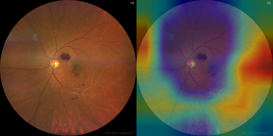
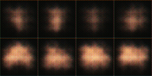

# Retinal Fundus Classification: CNN, Transfer Learning and AC-GAN

Can a colour fundus photograph reveal **systemic** conditions (diabetes mellitus,
hypertension, heart disease, high cholesterol)? This repository is a reproducible,
leakage-safe pipeline for studying that question on a small clinician-provided dataset.
It covers data integrity checks, patient/group-aware splits, transfer learning, baselines,
bootstrap confidence intervals, Grad-CAM shortcut detection, a class-conditional AC-GAN
for augmentation, and a demo app.

> **Status: research prototype, not a diagnostic tool.** An audit found that the
> original results (binary AUC ~98%) came from data leakage. The repository now holds
> 38 unique source images, which is too few to support any performance claim. The
> pipeline is complete and tested, and is ready for the original full dataset.

---

## What changed and why (audit summary)

| Finding | Evidence | Fix |
|---|---|---|
| 98.4% of `dataset/` were offline-augmented copies of **38** source images, split *after* augmentation, so near-duplicates sat in train, val and test | `python -m src.data.integrity dataset` → `data/integrity_report.txt` | De-duplicated manifest of originals; augmentation only on the fly inside training |
| 5 byte-identical images in more than one split; 11 images filed under several disease labels | same report | Group-aware split; multi-label task formulation keeps comorbidity |
| Test split had 1 image for three of five classes; all reported metrics were validation metrics | split counts | Held-out test split, metrics with bootstrap CIs, `null` where undefined |
| Histogram equalization ran on rescaled floats, returning ~0-255 luminance-only images | `tests/test_preprocessing.py` | Shared, colour-preserving `src/preprocessing.py` |
| 3-class scripts built 5-output models; evaluation scripts crashed; committed `.h5` weights matched none of the scripts | `legacy/`, `tests/test_script_regressions.py` | Fixed; superseded by one config-driven pipeline |
| AC-GAN trained on an unrelated glaucoma dataset and never fed the classifier | `legacy/acgan/` | New AC-GAN on the project's train split + KID/FID + ablation |
| README claimed Grad-CAM, but no code existed | — | `src/explain/gradcam.py` with an outside-the-retina attention check |

---

## Results

Measured on the 38 unique source images in this repository (group-aware split: 28 train /
5 val / 5 test for the multi-label task). Full tables, split counts and ablations:
[docs/results.md](docs/results.md), regenerated with `python -m src.experiments.report`.

| Model (multi-label, 4 conditions) | Test macro AUC (n=5) | 5-fold out-of-fold macro AUC (n=33) |
|---|---|---|
| Class-prior baseline | 0.50 | — |
| Colour-histogram logistic regression | 0.42 | — |
| ImageNet-embedding logistic regression | 0.58 | — |
| Original small CNN (from scratch) | 0.61 | — |
| EfficientNet-B0 transfer learning | 0.42 | **0.56 [95% CI 0.45, 0.67]** |

**How to read this.** No model is distinguishable from chance. The single defensible
estimate is the cross-validated one, and its confidence interval includes 0.5. Test-set
numbers come from 5 images and are noise; CIs are withheld below n = 10. This is the
expected outcome at this sample size. It replaces the original 98% AUC, which was an
artefact of leakage.

Other findings:
* **Shortcut risk.** Grad-CAM puts 26-27% of the attention outside the retinal disc,
  often on the black border and the camera text ("OS", "ZEISS CLARUS"). Any future
  positive result should be checked for this first.

  
* **AC-GAN.** Trained on the 16 single-label train images, it produces blurry,
  structure-less samples (pooled KID 0.46). Adding 10 or 40 GAN images per class changed
  nothing measurable (3 seeds). GAN augmentation can't help when it has so little to learn
  from. Its samples differ between classes mainly in brightness, which suggests exposure or
  camera differences between the class groups (another potential confound).

  
* **Augmentation / equalization ablation** (3 seeds): all differences are within
  seed-to-seed spread.
* **Reproducibility.** Re-running the EfficientNet config with the same seed reproduced its
  test metrics exactly. Each run records its git commit, manifest hash and environment.

### Verification status
* 123 automated tests pass (unit, regression and TensorFlow end-to-end on synthetic data),
  and `ruff check` is clean, in three places: a local Linux Python 3.11 environment (WSL),
  the Docker image, and GitHub Actions CI.
* The Docker image builds from the `Dockerfile`, and lint plus the full test suite pass inside it.
* All results above were produced by the commands in this README.
* The Gradio demo was launched and exercised end to end through its API.

---

## Quick start

All commands run from the repository root. Requires **Python 3.10 or 3.11** (TensorFlow 2.15).

```bash
python -m venv .venv && . .venv/bin/activate        # Windows: .venv\Scripts\activate
pip install -r requirements-dev.txt -r requirements-app.txt
python -m pytest                                     # unit, regression and TF end-to-end tests
```

Or with Docker (no local Python/TensorFlow needed):

```bash
docker build -t retina .
docker run --rm -v "$PWD:/app" retina python -m pytest
```

### 1. Data: check, de-duplicate, split
```bash
python -m src.data.integrity dataset                          # exits 1 on leakage
python -m src.data.manifest build <originals_dir> --out data/manifest.csv [--patients patients.csv]
python -m src.data.manifest split data/manifest.csv --out data/manifest_split.csv --seed 42
```

### 2. Train and evaluate
```bash
python -m src.train --config configs/multilabel_efficientnet.yaml
python -m src.train --config configs/multilabel_efficientnet.yaml --set cv_folds=5     # k-fold CV + held-out test
python -m src.evaluation.baselines --config configs/multilabel_efficientnet.yaml --embeddings
python -m src.explain.gradcam --run outputs/runs/<run>
```
Each run writes `outputs/runs/<name>-<time>/` with the config, git commit, data-manifest
hash, environment, training history, metrics (with 95% CIs), per-image predictions and the
model.

### 3. GAN augmentation experiment
```bash
python -m src.gan.acgan train --config configs/acgan.yaml --run-dir outputs/gan/acgan
python -m src.gan.acgan generate --run outputs/gan/acgan --per-class 50 --out outputs/synthetic/acgan
python -m src.gan.fid --classes DM Hypertension --fake outputs/synthetic/acgan
python -m src.experiments.ablation --spec configs/ablation_gan.yaml
```

### 4. Inference and demo
```bash
python -m src.predict --run outputs/runs/<run> image.jpg
python -m app.demo --run outputs/runs/<run>          # http://127.0.0.1:7860
```

---

## Design decisions

* **Multi-label is the primary task.** 11 of the 38 source images carry more than one
  disease label. A softmax would force a false choice, so the main model predicts one
  sigmoid per condition. The multi-class configs exclude ambiguous images instead of
  silently picking a label.
* **Transfer learning over training from scratch.** With dozens of images, an
  ImageNet-pretrained EfficientNet-B0 (head first, then the top layers with BatchNorm
  frozen) is the defensible choice. The original CNN is kept as `small_cnn` for comparison.
* **Every number has a baseline and a confidence interval.** Class-prior and
  logistic-regression baselines share the same split, and percentile-bootstrap 95% CIs
  come from `src/evaluation/metrics.py`. Undefined metrics are reported as `null`, never
  imputed.
* **Cross-validation is honest.** Folds are grouped and stratified, with a fixed epoch
  budget (no early stopping on the scored fold), and the test split is never touched until
  the final model.
* **Shortcut detection.** Grad-CAM reports how much attention falls *outside* the retinal
  disc. High values mean the model is reading borders or artifacts, not anatomy.
* **GAN images never leak.** The AC-GAN trains on the train split only, and synthetic
  images are added to training folds only, so they can't inflate evaluation.

## Repository layout

```plaintext
src/
  data/integrity.py        leakage and duplicate checks (CI gate)
  data/manifest.py         de-duplicated manifest + group-aware split
  data/dataset.py          task-specific selection, loading, tf.data + augmentation
  preprocessing.py         colour-preserving histogram equalization
  models/factory.py        small_cnn, EfficientNet-B0, MobileNetV2
  train.py                 training / CV / evaluation / run bundle
  evaluation/              metrics (+bootstrap CIs, calibration), baselines
  explain/gradcam.py       Grad-CAM + outside-fundus attention
  gan/                     AC-GAN (train/generate), KID/FID
  experiments/ablation.py  variants x seeds → results table
  predict.py               CLI inference
app/demo.py                Gradio demo with Grad-CAM overlay
configs/                   experiment, GAN and ablation configs
data/                      manifest.csv, manifest_split.csv, integrity report
docs/                      architecture, model card, data versioning
legacy/, models/legacy/    original scripts and weights (provenance only)
dataset/                   original image tree (folder names are the OLD leaky split; the
                           manifest's `split` column is authoritative)
tests/                     unit, regression and end-to-end tests
```

See [docs/architecture.md](docs/architecture.md) for the data-flow diagram,
[docs/model_card.md](docs/model_card.md) for intended use and limitations, and
[docs/data_versioning.md](docs/data_versioning.md) for moving the images out of git.

## Limitations

* 38 unique images, one healthy control, no patient IDs: results cannot generalize, and
  CIs are very wide.
* The label semantics for multi-label images (comorbidity vs. filing error) are unconfirmed.
* Single source and camera; no external validation.
* Not a medical device. Don't use it for any clinical purpose.
