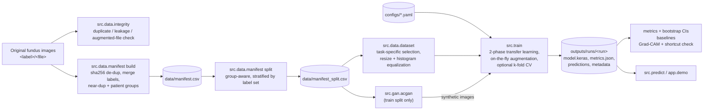

# Architecture

## Data and training flow

## Components

| Module | Responsibility | Key decisions |
|---|---|---|
| `src/data/integrity.py` | Finds identical images across splits/labels; flags Keras offline-augmentation files | Exits non-zero so it can gate CI or training |
| `src/data/manifest.py` | One row per unique image; group-aware split | Images filed under several labels keep all labels instead of becoming contradictory samples; whole groups (near-duplicates, same patient) go to one split |
| `src/data/dataset.py` | Selects images for a task, loads, resizes, equalizes | Multi-class excludes ambiguous images rather than picking one label; multi-label encodes comorbidity |
| `src/preprocessing.py` | Luminance histogram equalization | Colour-preserving; fixes the scale bug of the legacy scripts |
| `src/models/factory.py` | `small_cnn` (original), EfficientNet-B0, MobileNetV2 | Models take raw [0,255] pixels and normalize internally, so the saved model is self-contained |
| `src/train.py` | Training, evaluation, run bundle | Head-then-fine-tune; BatchNorm frozen; CV uses a fixed epoch budget so out-of-fold scores are not tuned on |
| `src/evaluation/metrics.py` | Multi-class / multi-label metrics | Bootstrap 95% CIs; undefined metrics reported as `null`, never imputed |
| `src/evaluation/baselines.py` | Prior, colour-histogram LR, ImageNet-embedding LR | Every CNN number is read against these |
| `src/explain/gradcam.py` | Grad-CAM and outside-fundus attention share | Detects shortcut learning on borders/artifacts |
| `src/gan/acgan.py`, `src/gan/fid.py` | Conditional GAN on train split; KID/FID | DiffAugment for tiny data; KID preferred over FID at small n |
| `src/experiments/ablation.py` | Variants x seeds -> table | Mean ± std across seeds; differences within std are not evidence |
| `src/predict.py`, `app/demo.py` | CLI and Gradio inference with Grad-CAM | Low-confidence flag and research-only disclaimer |

## Legacy code

`legacy/` holds the original per-experiment scripts (with the Stage 1 bug fixes) and
`models/legacy/` the original `.h5` weights. Those weights were trained on the leaky split
with an architecture that differs from the scripts in the repo; they are kept for
provenance only and are not used by the new pipeline.
